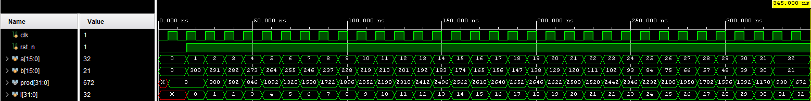
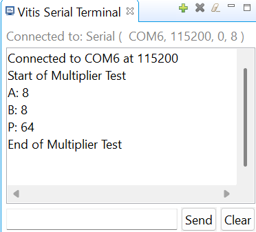
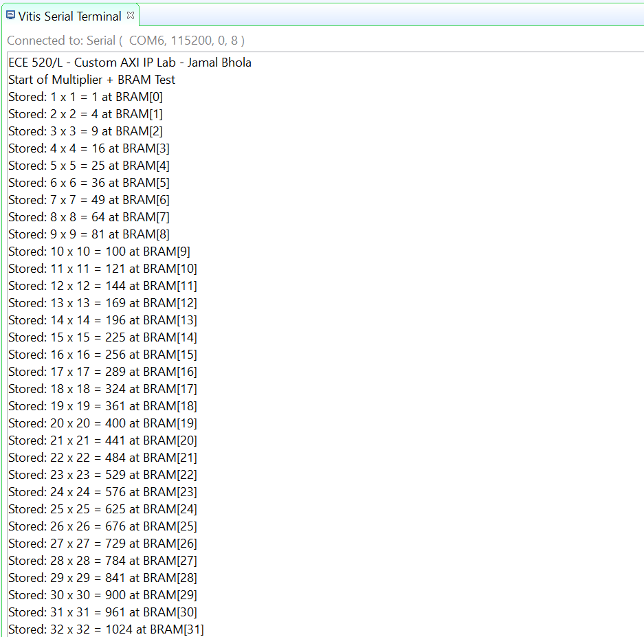
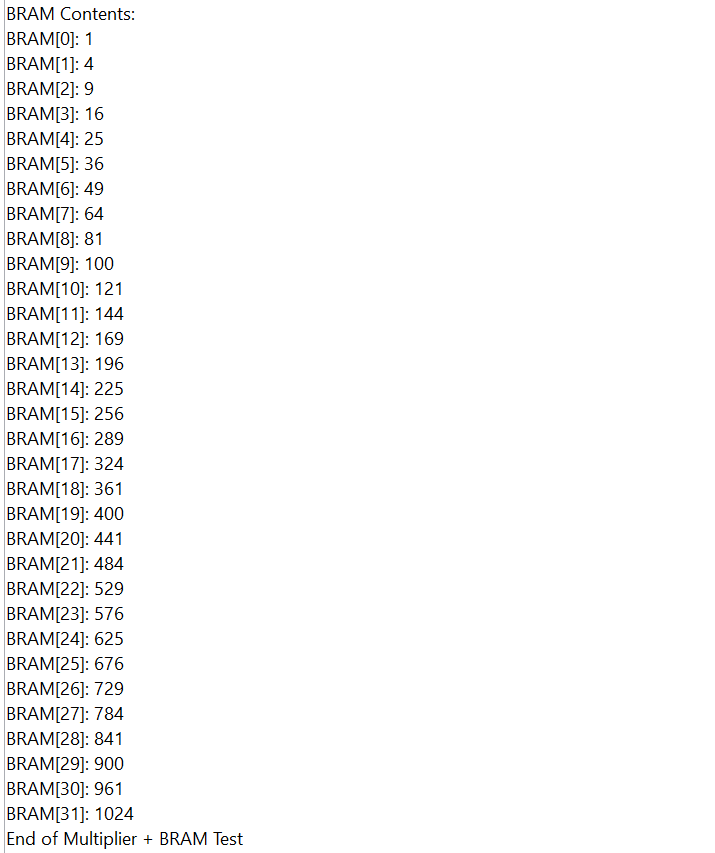
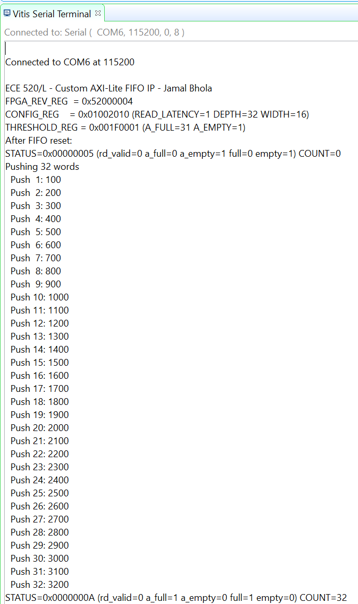
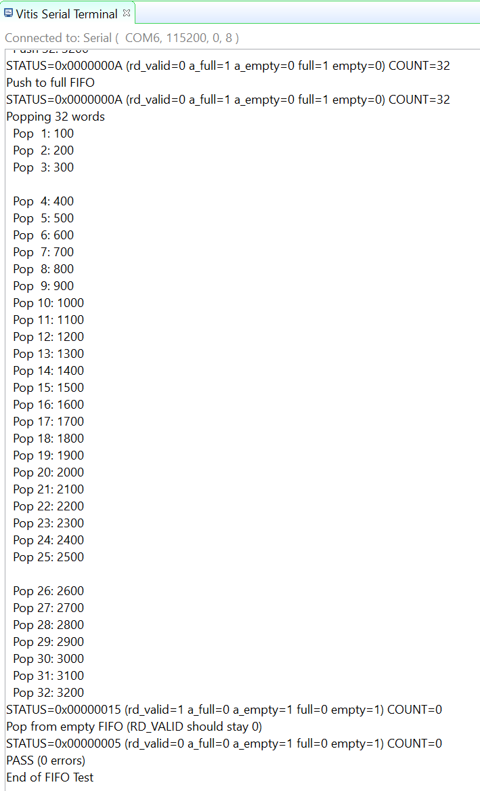

# ECE 520/L Lab 4: Custom AXI-Lite IP

## Overview

In this lab I built custom AXI4-Lite peripherals in the Zynq-7000 Programmable Logic (PL) and controlled them from software running on the ARM Cortex-A9 in the Processing System (PS). The lab had three parts:

1. **16-bit multiplier AXI IP.** I wrote and simulated a registered 16-bit × 16-bit unsigned multiplier, then packaged it as an AXI4-Lite peripheral (`mult_16_bit`) with three memory-mapped registers: operand A, operand B, and a read-only product. I added it to a Zynq block design, exported the hardware to Vitis, and tested it with a bare-metal C program.
2. **Multiplier + BRAM.** I added an AXI BRAM Controller and a Block Memory Generator to the block design. The software runs 32 multiplications and stores each product in BRAM using word addressing, then reads the BRAM back.
3. **AXI-Lite FIFO IP.** I wrapped my Lab 3 BRAM-based synchronous FIFO (`sc_fifo`) in a second custom AXI4-Lite IP (`sc_fifo_axi`). Software controls it through a register map with read-only, write-only, and reserved registers. It pushes and pops words, reads status flags and the data count, and reads back the FIFO's configuration parameters.

## Components Used

### Hardware

| Description | Quantity | Manufacturer |
|---|---|---|
| Zybo Z7-10 ARM/FPGA SoC board (`xc7z010clg400-1`) | 1 | Digilent |
| USB-A to Micro-USB cable | 1 | N/A |

### Software

- AMD Vivado 2023.2 (RTL design, simulation, IP packaging, block design, bitstream)
- AMD Vitis 2023.2 (Classic) (platform projects, bare-metal C applications, serial terminal)

### Block design IP (`mult_bd_jb`)

| IP | Instance | Purpose |
|---|---|---|
| ZYNQ7 Processing System | `processing_system7_0` | ARM PS; AXI master (M_AXI_GP0), FCLK_CLK0, and reset |
| AXI Interconnect | `ps7_0_axi_periph` | Connects the PS master to the three AXI slaves |
| Processor System Reset | `rst_ps7_0_50M` | Synchronized reset for the PL peripherals |
| **Custom** 16-bit multiplier AXI IP | `mult_16_bit_0` | AXI4-Lite multiplier peripheral |
| AXI BRAM Controller | `axi_bram_ctrl_0` | AXI access to the block RAM |
| Block Memory Generator | `blk_mem_gen_0` | Stores the multiplication results |
| **Custom** AXI-Lite FIFO IP | `sc_fifo_axi_0` | Lab 3 FIFO behind an AXI4-Lite register map |

### Address map (from the Vivado Address Editor)

| Slave | Base address | High address | Range |
|---|---|---|---|
| `axi_bram_ctrl_0` | `0x4000_0000` | `0x4000_FFFF` | 64K |
| `mult_16_bit_0` | `0x43C0_0000` | `0x43C0_FFFF` | 64K |
| `sc_fifo_axi_0` | `0x43C1_0000` | `0x43C1_FFFF` | 64K |

### Repository layout

| Path | Contents |
|---|---|
| `ECE_520_Lab_4_AXI_Lite.srcs/sources_1/new/multiplier_16_bit.v` | 16-bit multiplier RTL |
| `ECE_520_Lab_4_AXI_Lite.srcs/sim_1/new/tb_multiplier_16_bit.v` | Multiplier testbench |
| `tb_multiplier_16_bit_behav.wcfg` | Saved waveform configuration |
| `ip_repo/mult_16_bit_1_0/` | Packaged multiplier AXI IP (`hdl/mult_16_bit_v1_0_S00_AXI.v` holds the user logic) |
| `ip_repo/sc_fifo_axi_1_0/` | Packaged FIFO AXI IP (`hdl/sc_fifo_axi_v1_0_S00_AXI.v`, `src/sc_fifo.vhd`, `src/blk_mem_gen_0`) |
| `mult_soc_jb/` | SoC Vivado project, block design `mult_bd_jb`, and exported `.xsa` files |
| `mult_soc_jb/mult_soc_vitis/mult_app/` | Part 1 multiplier test application |
| `mult_soc_jb/mult_soc_vitis/mult_app_BRAM/` | Part 2 multiplier + BRAM application |
| `mult_soc_jb/mult_soc_vitis/fifo_app/` | Part 3 FIFO IP test application |
| `Figures/` | Screenshots used in this report |

## Analysis and Results

### 1. 16-bit multiplier RTL and simulation

The multiplier takes two 16-bit unsigned operands and produces a registered 32-bit product. The reset is synchronous and active low:

```verilog
module multiplier_16_bit(
    input clk,
    input rst_n,
    input [15:0] a,
    input [15:0] b,
    output reg [31:0] prod
    );
    always @(posedge clk) begin
        if (!rst_n)
            prod <= 32'b0;
        else
            prod <= a*b;
    end
endmodule
```

The testbench `tb_multiplier_16_bit` generates a 100 MHz clock (`#5` half period) and holds reset for two cycles. A `for` loop then applies 32 operand pairs, one per clock cycle, with `a = i + 1` and `b = 300 - 9i` for `i = 0 … 31`.



*Figure 1: Behavioral simulation of `multiplier_16_bit`.*

**Analysis:**
- `prod` is `X` until the first rising edge, when the active reset clears it to 0.
- Because the output is registered, each product appears **one clock cycle after** its operands. For example, `a = 1, b = 300` is applied and `prod = 300` shows up on the next edge. After that come `2 × 291 = 582`, `3 × 282 = 846`, `4 × 273 = 1092`, and so on.
- The products rise to a peak of `2652` (`18 × 147`) and then fall back down, because `a` increases while `b` decreases. That matches the expected shape for these inputs.
- The last pair, `a = 32, b = 21`, gives `prod = 672`, which is correct.

### 2. Multiplier AXI4-Lite IP

I generated the IP with **Tools → Create and Package New IP → Create a new AXI4 peripheral**, as an AXI4-Lite slave (32-bit data, 16 registers, 6-bit address). I then edited the user logic in `mult_16_bit_v1_0_S00_AXI.v`:

| Offset | Register | Access | Description |
|---|---|---|---|
| `0x00` | `slv_reg0` | R/W | Operand A (bits [15:0]; the upper 16 bits always read 0) |
| `0x04` | `slv_reg1` | R/W | Operand B (bits [15:0]; the upper 16 bits always read 0) |
| `0x08` | `slv_reg2` | RO | 32-bit product from `multiplier_16_bit` |

- `slv_reg0[15:0]` and `slv_reg1[15:0]` are registered into `a_in` and `b_in`, which drive the multiplier instance. The multiplier is clocked by `S_AXI_ACLK` and reset by `S_AXI_ARESETN`.
- The read mux returns `{16'd0, slv_reg0[15:0]}`, `{16'd0, slv_reg1[15:0]}`, and `prod_out` for offsets `0x00`, `0x04`, and `0x08`.
- The write-decode case for `4'h2` was changed to `slv_reg2 <= slv_reg2;`, so the product register is read-only and software writes to it are ignored.

The IP was then re-packaged and added to the `mult_soc_jb` block design. Run Block Automation and Run Connection Automation created the AXI interconnect and the reset block. Before building the Vitis platform (`mult_plat`), I set the auto-generated `mult_16_bit_0` driver to **none** in both the `zynq_fsbl` and `standalone` BSPs, as the lab instructs.

The test program `mult_app` writes `A = 8` and `B = 8` and reads back all three registers:



*Figure 2: Vitis Serial Terminal output (COM6, 115200 baud) for the multiplier AXI IP test.*

The readback shows `A = 8`, `B = 8`, and `P = 64`. This confirms that the PS can write the operand registers over AXI and read the product register, and that the multiplier works in hardware.

### 3. Multiplier + BRAM (Tasks 5.1 and 5.2)

**Hardware:** I added an AXI BRAM Controller and a Block Memory Generator to the block design and connected them with connection automation. In the Address Editor I set the BRAM range to **64K** (base `0x4000_0000`, high `0x4000_FFFF`). Then I validated the design, regenerated the bitstream, exported a new XSA, and created a new platform (`mult_plat_BRAM`). The multiplier driver was removed from the BSPs again.

**Software:** `mult_app_BRAM` runs 32 multiplications (`(i+1) × (i+1)` for `i = 0 … 31`). Each product is stored at `BRAM_BASE_ADDR + 4*i`, which is word addressing because each 32-bit product takes one 4-byte word. After all 32 stores, the program reads the BRAM back and prints its contents.

```c
for (int i = 0; i < 32; i++) {
    Xil_Out32(A_REG_ADDR, i+1);
    Xil_Out32(B_REG_ADDR, i+1);
    Xil_Out32(BRAM_BASE_ADDR + (i*4), Xil_In32(P_REG_ADDR));
    ...
}
```



*Figure 3: Each product is computed by the multiplier IP and written to BRAM.*



*Figure 4: The BRAM contents read back after all 32 writes.*

**Analysis:** All 32 products (`1, 4, 9, …, 961, 1024`) are correct. The second pass reads the same values back from `BRAM[0]` through `BRAM[31]`, which shows that the results were stored in the block RAM and not just echoed from the multiplier's product register.

### 4. Custom AXI-Lite FIFO IP (`sc_fifo_axi`)

I packaged my Lab 3 `sc_fifo` (VHDL, built on a `blk_mem_gen_0` simple dual-port BRAM) inside a new AXI4-Lite peripheral named `sc_fifo_axi`. It uses the same AXI4-Lite settings as the multiplier IP (32-bit data, 16 registers at offsets `0x00` through `0x3C`). Offsets `0x00` through `0x20` are used by the register map. Since the FIFO is written in VHDL and the AXI wrapper in Verilog, the IP is mixed-language. I added it to the same `mult_bd_jb` block design at `0x43C1_0000`.

#### Register map

| Offset | Name | Access | Reset value | Implementation |
|---|---|---|---|---|
| `0x00` | `FPGA_REV_REG` | RO | `0x5200_0004` | Constant `FPGA_REV_VALUE` |
| `0x04` | `FIFO_RST_REG` | WO | `0x0000_0000` | Writing 1 to bit 0 pulses `srst` for one clock |
| `0x08` | `WR_DATA_REG` | WO | `0x0000_0000` | Each write latches `WDATA[15:0]` and pulses `write_enable` |
| `0x0C` | `RD_REQ_REG` | WO | `0x0000_0000` | Writing 1 to bit 0 pulses `read_enable` |
| `0x10` | `RD_DATA_REG` | RO | `0x0000_0000` | `data_out`, captured when `valid` is asserted |
| `0x14` | `STATUS_REG` | RO | `0x0000_0005` | `{27'd0, RD_VALID, ALMOST_FULL, ALMOST_EMPTY, FULL, EMPTY}` |
| `0x18` | `DATA_COUNT_REG` | RO | `0x0000_0000` | `data_count` (6 bits for DEPTH = 32) |
| `0x1C` | `CONFIG_REG` | RO | `0x0100_2010` | `{4'd0, READ_LATENCY, DEPTH, WIDTH}` |
| `0x20` | `THRESHOLD_REG` | RO | `0x001F_0001` | `{ALMOST_FULL_THRESHOLD, ALMOST_EMPTY_THRESHOLD}` |
| `0x24`+ | Reserved | — | `0x0000_0000` | Reads as 0 |

#### How the design meets the specification

1. **Parameters, not constants.** The FIFO parameters (`WIDTH = 16`, `DEPTH = 32`, `ALMOST_EMPTY_THRESHOLD = 1`, `ALMOST_FULL_THRESHOLD = 31`, `READ_LATENCY = 1`) are `localparam`s. The same values are passed to the `sc_fifo` instance and used to build `CONFIG_REG` and `THRESHOLD_REG`, and the `DATA_COUNT` width is `$clog2(DEPTH + 1)`. If a parameter changes, the reported values change with it.
2. **Clock and reset.** `S_AXI_ACLK` drives the FIFO clock. The active-high FIFO reset is `fifo_srst = ~S_AXI_ARESETN | fifo_rst_pulse`, so the FIFO resets on an AXI reset or when software writes 1 to `FIFO_RST_REG`.
3. **Single-cycle command pulses.** `write_enable`, `read_enable`, and the software reset are not driven from `slv_reg1`, `slv_reg2`, or `slv_reg3`. Each comes from its own pulse register, which is high for exactly one `S_AXI_ACLK` cycle after the matching AXI write handshake (`slv_reg_wren`):
   ```verilog
   fifo_wr_pulse  <= slv_reg_wren && (wr_index == 4'h2);
   fifo_rd_pulse  <= slv_reg_wren && (wr_index == 4'h3) && S_AXI_WDATA[0];
   fifo_rst_pulse <= slv_reg_wren && (wr_index == 4'h1) && S_AXI_WDATA[0];
   ```
4. **Two-step pop.** Writing 1 to `RD_REQ_REG` pulses `read_enable` and clears `RD_VALID`. When `sc_fifo` asserts `valid` one `READ_LATENCY` later, `data_out` is captured into `RD_DATA_REG` and `RD_VALID` is set. Software polls `STATUS_REG[4]` and then reads `RD_DATA_REG`. Reading `RD_DATA_REG` does not pop the FIFO.
5. **Access rules.** The read mux returns constants or live FIFO signals for the RO registers, so software writes to them have no effect. The WO registers (`0x04`, `0x08`, `0x0C`), the reserved bits, and the unused offsets all read as 0.
6. **Full and empty protection.** `sc_fifo` ignores writes when it is full and reads when it is empty. A pop request on an empty FIFO never asserts `valid`, so `RD_VALID` stays 0.

#### Software test (`fifo_app`)

Vitis platform `fifo_plat` was built from `fifo_bd_jb_wrapper.xsa`. The test program does the following:

1. Prints `FPGA_REV_REG`, then decodes and prints `CONFIG_REG` and `THRESHOLD_REG`.
2. Writes 1 to `FIFO_RST_REG` and prints `STATUS_REG` and `DATA_COUNT_REG`.
3. Pushes 32 words (`100, 200, …, 3200`) to fill the FIFO.
4. Pushes `0xFFFF` into the full FIFO to check that the write is ignored.
5. Pops 32 words with the request → poll `RD_VALID` → read sequence (1000-iteration timeout) and compares each word with its expected value, which checks FIFO ordering.
6. Requests a pop from the empty FIFO and checks that `RD_VALID` stays 0.
7. Prints `PASS` or `FAIL` with an error count.



*Figure 5: `fifo_app` on the Zybo Z7. The identification and configuration registers are read back, the FIFO is reset, and 32 words are pushed.*



*Figure 6: `fifo_app` continued. A push into the full FIFO, 32 pops, a pop from the empty FIFO, and the final PASS result.*

**Analysis:**

| Step | `STATUS_REG` | `DATA_COUNT` | Result |
|---|---|---|---|
| ID and configuration readback | — | — | `FPGA_REV_REG = 0x52000004`, `CONFIG_REG = 0x01002010` (READ_LATENCY = 1, DEPTH = 32, WIDTH = 16), `THRESHOLD_REG = 0x001F0001` (A_FULL = 31, A_EMPTY = 1). All three match the reset values in the register map. |
| After FIFO reset | `0x05` | 0 | `EMPTY` and `ALMOST_EMPTY` set, which matches the specified reset value of `STATUS_REG`. The software reset works. |
| After 32 pushes | `0x0A` | 32 | `FULL` and `ALMOST_FULL` set, `EMPTY` and `ALMOST_EMPTY` clear. Each write to `WR_DATA_REG` pushed exactly one word, so the write pulse lasts a single cycle. |
| Push into the full FIFO | `0x0A` | 32 | The count stays at 32, so the overflow write was ignored. |
| After 32 pops | `0x15` | 0 | Words come out as `100, 200, …, 3200`, in the order they were pushed, with no mismatches or timeouts. `RD_VALID` is still 1 from the last pop. `EMPTY` and `ALMOST_EMPTY` are set again. |
| Pop from the empty FIFO | `0x05` | 0 | The request cleared `RD_VALID`, and it stayed 0 because the FIFO had no data to return. Underflow is handled correctly. |

The test ended with **PASS (0 errors)**. This verifies the FIFO IP on hardware: the register map, the single-cycle command pulses, the two-step pop with `RD_VALID`, all four status flags, the data count, and overflow and underflow protection.

## Known Issues or Limitations


- **There are stray blank lines in the FIFO serial output.** In Figure 6, extra blank lines appear after `Pop 3` and `Pop 25`. Every value is still correct and in order, and the program reported 0 errors, so the gaps appear to come from the serial terminal display rather than from the FIFO.

## References

1. A. Nanas, *ECE 520/L Lab 4: Custom AXI-Lite IP*, Fall 2026 (`ece520L_fall26_lab4_custom_axi_lite_ip.pdf`).
2. AMD, *Vivado Design Suite User Guide: Creating and Packaging Custom IP (UG1118)*, "Creating a New AXI4 Peripheral." https://docs.amd.com/r/2023.1-English/ug1118-vivado-creating-packaging-custom-ip/Creating-a-New-AXI4-Peripheral
3. Digilent, *Zybo Z7 Reference Manual*. https://digilent.com/reference/programmable-logic/zybo-z7/reference-manual
4. Digilent, *Zybo Z7: Zynq-7000 ARM/FPGA SoC Development Board*. https://digilent.com/shop/zybo-z7-zynq-7000-arm-fpga-soc-development-board
5. ChipVerify, *Verilog for Loop*. https://www.chipverify.com/verilog/verilog-for-loop
6. Arm, *AMBA AXI and ACE Protocol Specification* (AXI4-Lite).
7. AMD, *AXI BRAM Controller LogiCORE IP Product Guide (PG078)* and *Block Memory Generator LogiCORE IP Product Guide (PG058)*.
